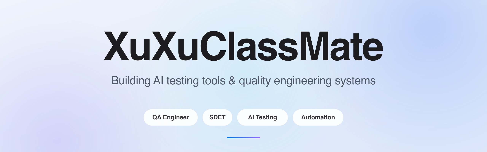

<picture>
  <source media="(prefers-color-scheme: dark)" srcset="img/banner-dark.png">
  
</picture>

  

&nbsp;

&nbsp;

&nbsp;

---

### About

- 🧪 Exploring **automation testing**, **test development**, and system quality
- 🚀 Building **AI testing tools** — a test-case generator and pullable test-DB Docker images
- 🐳 Built a **Docker Hub Analytics API** (REST + SVG stats card)
- 🌐 Currently learning **Web3 testing** and **Kubernetes**
- 📈 Focused on **business testing** and achieving personal OKRs
- 🔎 You can find me as `xuxuclassmate` across platforms

&nbsp;A little more about me

 

- 🎧 I enjoy music, walking, and playing **badminton**
- 🐶 Dog lover — especially Alaska 🐾
- 💡 Passionate about new technologies and engineering efficiency

---

### Selected work

- **[AI Test Case Generator](https://github.com/InnoNestX/testcase-generator)** — multimodal requirements → reviewable, structured test cases
- **[Test DB Docker Suite](https://hub.docker.com/u/xuxuclassmate)** — ready-to-run database images for QA and development
- **[Docker Hub API Gateway](https://github.com/InnoNestX/docker-hub-pull-counter)** — REST + SVG stats cards for Docker Hub
- **[GlobalPulse](https://github.com/InnoNestX/GlobalPulse)** — scheduled market-intelligence briefings on Cloudflare

---

### Analytics

&nbsp;

  

 

🐳 Powered by my own Docker Hub Analytics API

---

**Learn continuously · Build tools · Improve systems · Scale impact**

📝 More at [**xuxuclassmate.com**](https://www.xuxuclassmate.com)

